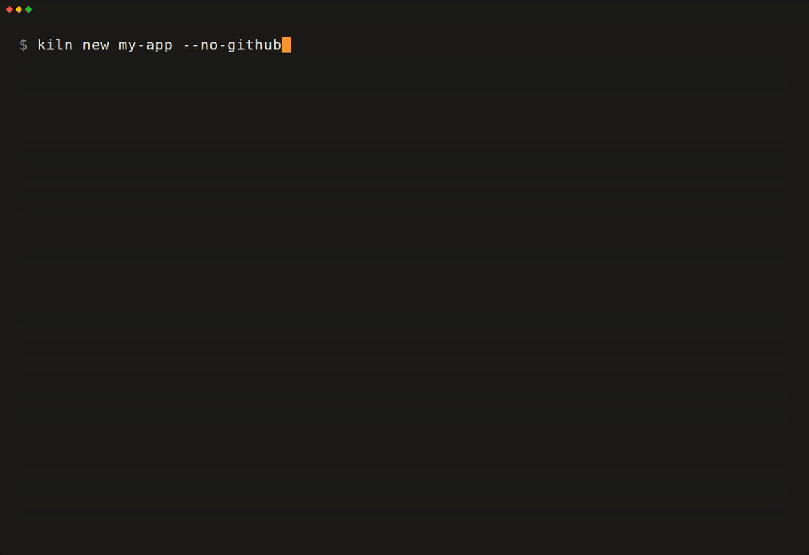
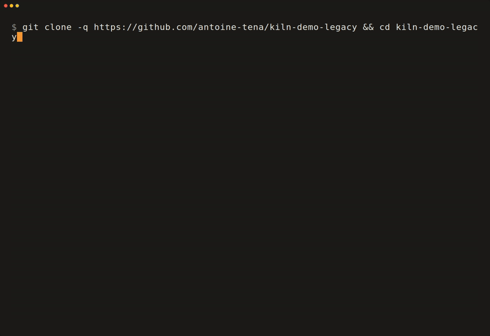
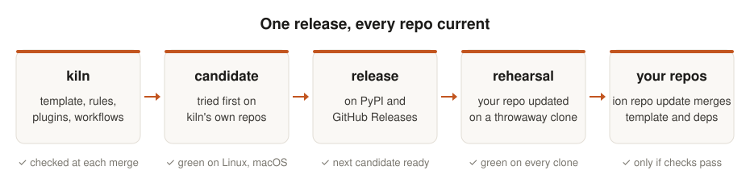
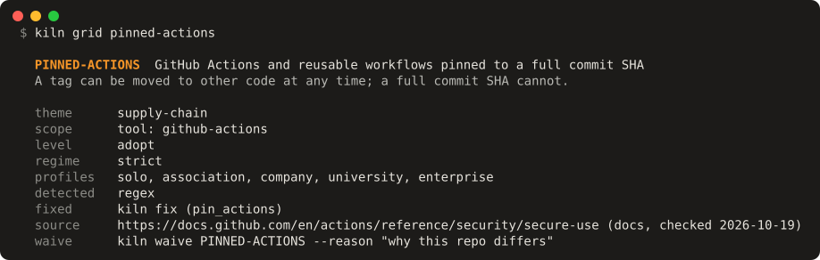

<div align="center">


# ion-repo

*L'atelier de Claude Code*

**Chaque nouveau projet démarré, et chaque vieux repo repris, comme le ferait un ingénieur expérimenté — même sans l'être soi-même.**

ion-repo donne à Claude Code de quoi construire des repos de qualité production, remettre les vôtres à ce niveau, et les garder ainsi.

[](https://pypi.org/project/kiln-cli/)
[](https://github.com/antoine-tena/ion-repo/actions/workflows/kiln.yml)
[](https://scorecard.dev/viewer/?uri=github.com/antoine-tena/ion-repo)
[](LICENSE)

[**Référence**](docs/reference.fr.md) · [Journal des versions](CHANGELOG.md) · [Contribuer](CONTRIBUTING.md) · [English](README.md)



<i>Une vraie exécution, jouée en 1,5× et coupée pendant les attentes : <code>ion repo new</code>, puis <code>ion repo check</code> et <code>ion repo score</code> dans le nouveau repo.</i>

</div>

Claude Code écrit vite. Un repo a besoin de plus pour rester sain : une stack à jour, des règles
qu'un agent ne peut pas contourner à force d'arguments, une façon de travailler avec git qui
résiste à un mauvais après-midi, et quelqu'un pour l'empêcher de vieillir au quatre-vingt-dixième
jour. ion-repo apporte les quatre à un nouveau repo en trois questions, et à celui que vous avez
déjà, si vieux et si sale soit-il : il pose les règles, liste ce qui n'y est pas, et Claude Code
le résorbe. Puis il tient chaque repo à jour, version après version. ion-repo lui-même n'appelle
aucune IA et ne demande aucune clé d'API.

## Points forts

- Un nouveau repo en trois questions (ce que vous construisez, sa taille, la langue de
  l'équipe) : code, tests, linters, CI, crochets pre-commit, conteneurs et les consignes que
  Claude lit en premier.
- Un repo que vous avez déjà, si vieux soit-il : `ion repo adopt` l'amène au niveau de `ion repo new`
  sur une branche de travail, en posant la CI, les crochets, les règles et les consignes qui lui
  manquent sans écraser aucun fichier. Les règles sont vérifiées après chaque modification de
  Claude, le passif qu'elles relèvent est listé pour que Claude le résorbe, et `ion repo update` le
  tient à jour comme un repo créé par ion-repo.
- `ion repo update` rejoue le modèle, prend les mises à jour compatibles des dépendances, convertit
  ce qu'une version a renommé et lance vos contrôles avant que vous ne commitiez. `--rehearse`
  l'essaie d'abord sur un clone jetable, `--all` met à jour chaque repo du dossier de code.
- `charter`, le contrôleur de règles d'ion-repo, vérifie chaque fichier que Claude modifie en
  0,15 s environ : outils bannis, noms, tailles de fichiers, données personnelles dans les logs.
  Des compteurs qui ne peuvent que baisser (cliquets) et des seuils de couverture tiennent à
  chaque commit et en CI. Une dérogation demande une raison et une date de fin.
- `ion repo grid` liste les pratiques qu'ion-repo défend, chacune avec sa raison, ses sources
  (vérifiées et datées) et sa façon d'être détectée. `ion repo score` y mesure n'importe quel repo
  en une seconde environ, sans jeton : une note sur 100, une par pilier, et les écarts à
  combler d'abord. `ion repo fix` comble sur une branche ceux qu'un script peut combler, un
  commit par règle, chacun prouvé, mis de côté si vos contrôles passent au rouge.
  `ion repo score --roadmap` confie le reste à Claude Code en une courte liste, fichier et ligne
  compris, et `/repo:modernize` la traite, chaque écart prouvé comblé par `ion repo score --rule`.
  [kiln-bot](docs/reference.fr.md) apporte les correctifs en pull request chaque
  semaine, en un copier-coller.
- Des skills pour les worktrees, les fusions, les versions et les relectures ; des hooks qui
  tiennent Claude à l'écart de `main` et `develop` ; une status line qui montre la CI, les
  tickets et la production ; un compte rendu de fin de travail, le style de sortie `debrief`,
  qui donne l'état git réel, ce qui est cassé et la suite.
- La CI d'un repo privé tourne sur votre poste (`ion repo ci`, son verdict gardé en note git) et ne
  coûte aucune minute GitHub ; celle d'un repo public tourne sur GitHub, où c'est gratuit.

## Sauver un vieux repo

<p align="center">
  
</p>
<p align="center"><i>Une vraie exécution sur <a href="https://github.com/antoine-tena/kiln-demo-legacy">kiln-demo-legacy</a>, une application Django laissée telle qu'on l'écrivait vers 2020, jouée en 1,5× et coupée pendant les attentes ; les cinq minutes de Claude Code en accéléré.</i></p>

`ion repo score` lui donne 23/100. `ion repo adopt` pose les règles, les contrôles et les consignes de
ion-repo sans écraser un fichier (39), `ion repo fix` comble ce qu'un script peut combler, un commit par
règle (65), et `ion repo score --roadmap` confie le reste à Claude Code. `/repo:modernize` fige
d'abord par des tests ce que fait le code aujourd'hui, puis comble chaque écart dans son propre
commit, prouvé par `ion repo score --rule` : 100/100. Le README du repo de démo donne les commandes
pour la rejouer.

## Installation

```sh
uv tool install kiln-cli     # uv installe Python 3.14 s'il manque
kiln install                 # hors d'un repo : le plugin Claude Code d'ion-repo dans chaque session
```

La version publiée répond encore à `kiln`, son ancien nom : plus bas, lire `kiln` pour `ion repo`
jusqu'à l'arrivée d'`ion-repo` et d'`ion-sh` sur PyPI, à la prochaine release.

Avec Homebrew : `brew install antoine-tena/ion/kiln`. Ou pour essayer sans rien installer :
`uvx kiln-cli new mon-app` pour un nouveau repo, `uvx kiln-cli adopt` dans un repo que vous
avez déjà. macOS, Linux et Windows par WSL ;
[pnpm](https://pnpm.io/) pour les fronts JavaScript, [podman](https://podman.io/) pour les
conteneurs.

## Démarrage

Un nouveau repo :

```console
$ ion repo new mon-app            # trois questions, puis un dépôt GitHub privé (--no-github : local)
$ cd mon-app && ion repo dev      # serveurs en arrière-plan, bases d'abord, journaux proposés
$ ion repo check                  # ruff, mypy, ESLint, types, puis charter (--tests : les suites)
$ claude                      # Claude Code, avec les règles, skills et hooks d'ion-repo
```

Un repo que vous avez déjà, sur une branche de travail :

```console
$ git switch -c chore/ion-repo-adopt
$ ion repo adopt                  # ce qu'écrit ion repo new, aucun fichier écrasé ; puis le passif
$ claude                      # Claude Code le résorbe, avec les règles, skills et hooks d'ion-repo
```

## Ce que vous obtenez

| Vous construisez | Backend | Frontend |
|---|---|---|
| Une application complète (`app`) | Django + Django Ninja | Nuxt + Vue |
| Une API (`api`) | FastAPI | — |
| Un site de contenu (`site`) | — | Astro |
| Un tableau de bord de données (`dashboard`) | polars, marimo, Plotly | Streamlit |
| Une analyse de données (`analysis`) | polars, marimo, Plotly | — |
| Un outil en ligne de commande (`cli`) | Python, installable, avec son propre plugin Claude Code si on le veut | — |

Next.js, Vite + React, Dash et Java 25 + Maven sont là aussi, et les tests d'ion-repo génèrent et vérifient chaque
combinaison. Django et Nuxt sont complets ; les autres stacks sont figées mais entretenues : les
nouvelles règles de la grille vont d'abord à Django et Nuxt.

Chaque repo reçoit aussi uv, pnpm et podman (jamais pip, npm ni docker), une CI qui appelle les
workflows réutilisables d'ion-repo, des branches `main` et `develop` protégées, un `docs/backlog/`
de tickets typés, et une taille (`tiny`, `small`, `medium` ou `large`) qui règle le cérémonial
qu'il porte. Une application Django peut partir sur un VPS durci (Caddy, conteneurs en lecture
seule, retour arrière automatique, sauvegardes restaurées), un front Nuxt sur Vercel.

## Tenu à jour

<p align="center">
  <picture>
    <source media="(prefers-color-scheme: dark)" srcset="docs/assets/kiln-flow-dark.svg">
    
  </picture>
</p>

Une version d'ion-repo sort d'abord en candidate, taguée seulement quand sa CI est verte sous Linux
et macOS, y compris une mise à jour depuis chaque version depuis la v0.3.0, par un outil
installé. Elle est promue une fois rodée (24 heures, au moins un repo passé dessus ; 2 heures pour une
candidate de correctifs seuls), puis répétée sur un clone de
chaque repo avant que `ion repo update --all` la fusionne, un worktree par repo. Les repos citent les
workflows d'ion-repo à la version exacte qu'ils suivent : rien ne leur arrive entre deux versions,
et `ion repo update` montre les nouveautés de chaque version qu'il traverse. Un repo repris par
`ion repo adopt` se met à jour de la même façon.

## La grille

<p align="center">
  
</p>
<p align="center"><i><code>ion repo grid &lt;ID&gt;</code> : une règle en entier, avec sa raison, une source vérifiée à une date, et la façon pour un repo d'y déroger.</i></p>

Un petit fichier TOML par règle, sur deux axes : son thème (chaîne d'approvisionnement,
conteneurs, tests…) et sa portée (universelle, un langage, un framework, un outil). Chacune dit
pourquoi, cite des sources pesées dans un ordre fixe (documentation officielle, alertes de
sécurité, études mesurées, données d'adoption, blogs) et porte un niveau du Technology Radar de
Thoughtworks : adopter, essayer, évaluer, abandonner. Seules les règles adoptées comptent :
43 (chaîne d'approvisionnement, CI, conteneurs, tests, normes de code, sécurité de Django et de
Vue), chacune passée sur deux vrais repos pour traquer les faux positifs ; 96 brouillons
attendent derrière `ion repo grid --level assess`.
Chaque règle notée a un repo qui la respecte et un qui l'enfreint.

## Comparé à Copier et cookiecutter

ion-repo repose sur [Copier](https://copier.readthedocs.io) : chaque projet garde son
`.copier-answers.yml`, et Copier seul fonctionne toujours dessus. ion-repo ajoute ce qui vient
après le premier jour, et y laisse un peu d'étendue.

| | cookiecutter | Copier | **ion-repo** |
|---|:---:|:---:|:---:|
| Générer un projet | ✅ | ✅ | ✅ |
| N'importe quel langage ou framework | ✅ | ✅ | ❌ |
| Des modèles de la communauté pour démarrer | ✅ | ✅ | ❌ |
| Appliquer les évolutions du modèle aux projets existants | ❌ | ✅ | ✅ |
| Choisir la stack d'après ce que l'on construit | ❌ | ❌ | ✅ |
| Changer de stack plus tard (`ion repo set frontend=nuxt`) | ❌ | en partie | ✅ |
| Mettre à jour les dépendances et lancer les contrôles d'un coup | ❌ | ❌ | ✅ |
| Répéter, puis mettre à jour tous ses repos d'un coup | ❌ | ❌ | ✅ |
| Des workflows de CI partagés, cités à une version | ❌ | ❌ | ✅ |
| Un moteur de règles aux dérogations datées (`charter`) | ❌ | ❌ | ✅ |
| Skills, hooks et consignes pour Claude Code | ❌ | ❌ | ✅ |

ion-repo a des opinions, exprès. Pour un moteur de gabarits neutre, prenez Copier ; pour une façon
de travailler qui reste entretenue, prenez ion-repo, ou forkez-le et faites vôtres ses opinions.

## Référence

Chaque commande et chaque option, chaque clé de `ion repo set`, les workflows réutilisables, les
plugins Claude Code, le moteur de charte et la façon dont ion-repo sort ses versions :
[**docs/reference.fr.md**](docs/reference.fr.md). Dans un terminal, `ion-repo <commande> --help`.

## État

ion-repo fait tourner chaque jour une poignée de vrais repos, dont un en production. Un seul
mainteneur l'écrit avec Claude Code, sous les règles mêmes qu'il donne à vos repos. Il numérote
ses versions comme Claude Code : en `0.x`, chaque version monte le correctif, les changements
cassants viennent en tête du [journal](CHANGELOG.md) et `ion repo update` les convertit ; la mineure
marque une étape. Le semver strict commence à la 1.0. La suite est pour les repos que vous avez
déjà : n'importe quel repo Django ou Nuxt noté face à la grille en quelques secondes, puis mis à
niveau par script partout où un script le peut (v0.5.0). Ensuite Claude Code qui comble seul ce
qu'un script laisse, les organisations entières, chaque stack, CI et machine courantes, et la
promesse de stabilité de la 1.0, version par version : [**ROADMAP.fr.md**](ROADMAP.fr.md).

## Contribuer

Les issues et les pull requests sont bienvenues : voir [CONTRIBUTING.md](CONTRIBUTING.md), le
[code de conduite](CODE_OF_CONDUCT.md), et l'étiquette
[`good first issue`](https://github.com/antoine-tena/ion-repo/labels/good%20first%20issue) pour
commencer. Dans un repo ion-repo, `/repo:report` transforme un défaut d'ion-repo en issue ou en pull
request prête à poster, envoyée seulement avec votre accord. Si ion-repo vous fait gagner du temps,
une étoile aide d'autres à le trouver.

## Licence

[MIT](LICENSE)
