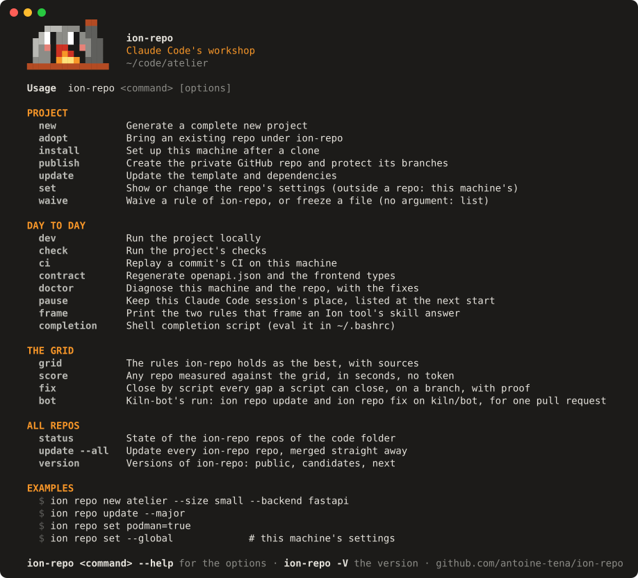
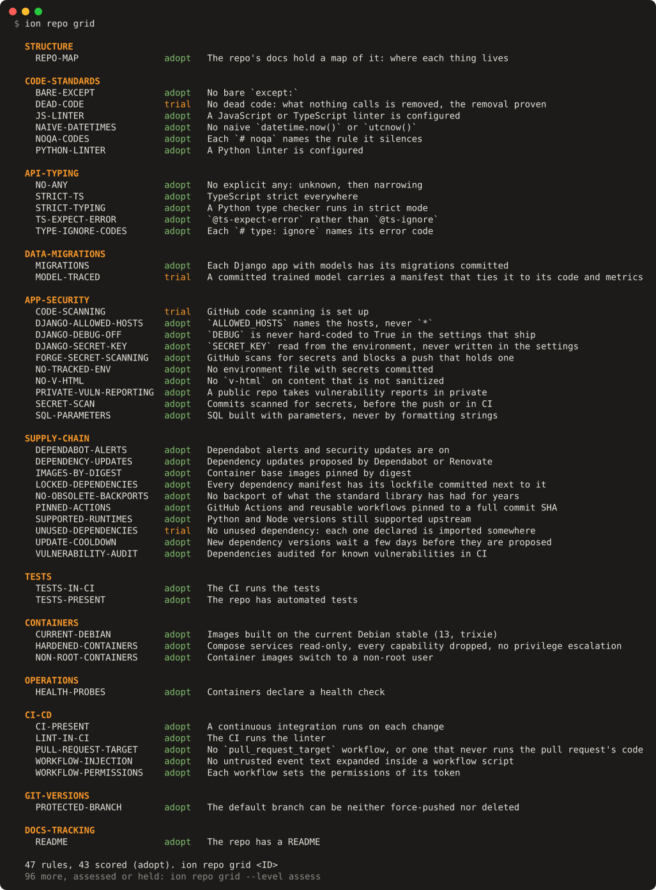
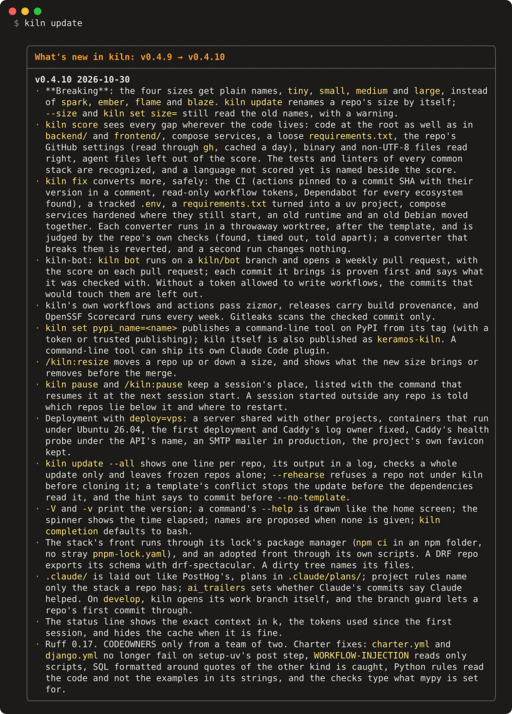

# kiln reference

Everything kiln offers, at the release it is: every command and option, every setting, the
reusable workflows and the Claude Code plugins. The [README](../README.md) shows what kiln is
for; this page is what you look things up in. `tests/test_docs.py` fails when a command,
option, setting, plugin, skill, hook or workflow is missing here.

*English · [Français](reference.fr.md)*

- [Commands](#commands)
- [Settings](#settings)
- [What a generated repo holds](#what-a-generated-repo-holds)
- [Reusable GitHub workflows](#reusable-github-workflows)
- [Claude Code plugins](#claude-code-plugins)
- [Releases](#releases)

## Commands

<p align="center">
  
</p>
<p align="center"><i><code>kiln</code> on its own: every command, grouped by what you are doing.</i></p>

| Command | What it does |
|---|---|
| `kiln new [dir]` | Questionnaire, generation, lockfiles, install, first commit on `main`, then `develop` where all work happens. Three questions (what you build, size, language), the rest by option: `--name`, `--title`, `--description`, `--type`, `--size`, `--backend`, `--frontend`, `--language`, `--owner`, `--team`, `--podman`, `--vps`, `--goal`, `--prod-url`; `--no-github` (local only), `--no-install`, `--template` (another source), `--all-questions` (the whole questionnaire). |
| `kiln adopt` | Bring an existing repo that kiln did not generate to the level of `kiln new` (`--template` for another source), on a work branch: the template rendered with what kiln finds in the repo (the stack, from the marker files of `backend/` and `frontend/`, or of the root when the code lives there: a Vite app or a `manage.py` at the root, recorded as `frontend_dir = "."` or `backend_dir = "."` in the answers, which CI, hooks, rules, charter, Dependabot, `kiln check` and `kiln dev` follow; the size via `--size`; the owner, from the `origin` remote) and every file the repo lacks laid: `CLAUDE.md`, `.claude/rules/kiln/`, the size's `charter.toml`, pre-commit hooks, the CI calling kiln's workflows, `docs/backlog/`. Never overwrites a file: those the repo has, and its code folders, are recorded under `kept` in `.copier-answers.yml`, which `kiln update` never writes either; the `.gitignore` gets the template's missing lines. Then the existing debt the charter finds. From then on `kiln update` replays the template like in a generated repo; a repo adopted before 0.4.6 is completed by `kiln adopt` again. |
| `kiln publish` | Create the private GitHub repo and protect its branches, for a project generated without `gh`. |
| `kiln install` | Set up a machine after a clone: tools, dependencies, `.env`, migrations, pre-commit. Outside a repo, or with `--machine`, kiln for the whole machine: the `kiln` command as a uv tool, the plugin catalogue and the `kiln` plugin at user scope (every Claude session), the machine's settings. Re-runnable: only what is missing is done. |
| `kiln dev` | Run the project on the machine, in the background. The code you edit runs there, reloaded at each change: the stack's servers and the processes a folder's `Procfile.dev` lists (`worker: uv run celery -A core worker`, in foreman's format). A folder the stack does not serve, such as an adopted repo with Vite and Express at its root, runs the `dev`, `dev:*`, `server`, `serve` and `watch` scripts of its `package.json` (`start` when there is none of them), with the package manager its lock names, its dependencies installed first when `node_modules/` is missing or older than the lock. The stack's front goes through its lock's manager too: an adopted Nuxt app kept on npm runs `npm run dev`, not `pnpm dev`. What you never edit runs in podman: the `db`, `postgres` and `redis` services of the compose file, restarted with their data and waited for (health check) when a process outside the front needs them. A server whose port another process already holds is not started: kiln names that process, or the worktree whose `kiln dev` holds it. A small project runs everything at once; from three processes on, kiln asks what to run (everything, as last time, the front alone, or one by one; the front alone reads its folder's `.env` and not its `.env.dev`, the full local stack's overrides, so it can run on a remote API), and `--only django,nuxt` answers without asking. Once each server answers, kiln shows where to open it and offers to follow the logs (Ctrl+C leaves them, the servers keep running). Then `kiln dev status`, `kiln dev logs [service]` (`-f`, `--follow`, to keep reading) and `kiln dev stop`, databases included unless another worktree of the repo still runs on them; `kiln dev` again shows what runs. `--foreground` keeps it in the terminal, output interleaved and prefixed by process in colour (`django │ …`), until Ctrl+C. `--containers` runs the whole stack in podman instead, as in production. In a repo kiln's stack does not serve, whose compose file runs the project's own services while kiln would run its `package.json` scripts, the terminal offers the compose services in podman or the scripts on the machine, the last answer kept as the default; outside a terminal the scripts run and the compose file is pointed to. Outside a terminal (a script, a Claude session), nothing is asked. |
| `kiln check` | Ruff and mypy for each Python project, ESLint and type checks for the front, then `charter`; the test suites (pytest, Maven tests) only with `--tests`, the release runs them all (`kiln ci`). Typing goes through `charter types` when the charter declares `[types]`; a Django backend's tests run on the throwaway PostgreSQL and Redis of the Django job of `ci.yml`, with its variables, as `kiln ci` replays them. Missing or outdated `node_modules` are installed from the lockfile first, a venv moved with its repo reinstalled. |
| `kiln set [key=value…]` | Show or change the repo's settings (see [Settings](#settings)); the repo is re-rendered. Outside a repo, or with `--global`, this machine's settings (`system`, `owner`, `team`, `code_dir`, `channel`, `statusline`, `ai_trailers` = whether Claude's commits and pull requests say Claude helped: `disclose`, the default and the answer to "choose for me" at the first `kiln install`, or `never`, which empties Claude Code's `attribution` and makes the branch guard refuse a `Co-Authored-By: Claude`); a key that only the machine has (`statusline`, `channel`, `system`, `code_dir`, `ai_trailers`) goes there from a repo too. |
| `kiln waive [RULE\|file]` | Waive a kiln rule (`--paths`, `--reason`), or freeze a generated file so `kiln update` leaves it alone; `--renew` moves to the next tier (a week, a month, three months, six months); `--permanent` for a waiver with no deadline, `--upstream` to link the issue or PR opened on kiln. No argument: list the waivers. |
| `kiln update` | Move to the latest kiln release (with a box listing what's new in each release crossed), compatible dependency upgrades, then checks. `--major`, `--no-template`, `--no-deps`. `--rehearse` plays it on a throwaway clone first and only reports, the repo untouched. After the template, `kiln fix`'s converters close what it leaves to the repo (actions and kiln's workflows pinned by SHA, digests), uncommitted like the rest; kiln's workflows pinned by SHA follow the next release without a conflict, then are pinned again. In an adopted repo (`kiln adopt`), only what belongs to kiln moves: its names of 0.3 first (`charte.toml` → `charter.toml` with the repo's rule identifiers kept, the `charte` command of its hooks, the workflows `charte.yml`, `contrat-api.yml`, `securite.yml` and their inputs; the files whose own text still cites them are listed; a `docs/a-faire/` becomes kiln's `docs/backlog/`, `AF-NN` tickets turned `T-NN` with the same numbers), then the references to kiln's workflows, to the latest public release (kiln's `develop` on the `beta` channel), their inputs checked. Only a release of kiln updates a repo: a tool built from a checkout is refused, with the command that installs the release. |
| `kiln update --all` | Update every kiln repo in your code folder, one worktree each, merged only if checks pass. `--all --rehearse`: each update on a clone, nothing touched, a summary per repo. |
| `kiln status` | Branch, clean tree, template release (`v0.4.0 → v0.4.2` when behind), waivers, stack — for every kiln repo, then the most waived rules across them. |
| `kiln version` | In kiln's own repo: latest public release, candidates (age, adopting repos, ready to promote), the number the next release should take and the planned tickets still open. `--minor` when the next one is a milestone. `kiln version cut` cuts the release branch with a drafted changelog entry, then (once the entry is rewritten) runs the checks, waits for GitHub's CI and tags `-rc.N` only on green; `kiln version promote` tags the ready candidate (green CI; `--urgent` skips the soak and the adopting repo), merges it into `main` and `develop`, and PyPI and the GitHub Release follow. |
| `kiln grid [RULE-ID]` | The grid: the practices kiln holds as the best today, one small TOML file per rule, each with its why, its sources (checked and dated), its level (adopt, trial, assess, hold) and how it is detected and fixed. `--theme`, `--scope`, `--level` filter; a rule ID shows it in full, with how to waive it. |
| `kiln score [PATH]` | Any repo, made by kiln or not, measured against the grid's scored rules in about a second, without a token: a score out of 100 and one per pillar (every rule that applies weighs the same; rules outside the repo's stacks, or with nothing to look at, are left out), the three gaps to close first, then each gap with its reason, where it is, its source and what closes it, and the score again at the end so that a long list does not scroll it out of sight. Waived rules (`kiln-waivers.toml`) are shown apart. What the files cannot say, the GitHub settings (the default branch neither force-pushed nor deleted, plus a linear history when the repo does not merge with merge commits; secret scanning and push protection; Dependabot alerts and security updates; private vulnerability reporting on a public repo), is read through `gh` when it is logged in with admin rights on the repo, each gap with the direct link to its settings page; kiln never reads, stores nor prints the token. Without that access these rules are left out and the score says the settings are unknown, never a failure. A read is kept a day (`~/.cache/kiln/forge/`) and skipped in CI, so a setting's detail stays on the owner's machine: the badge, a report to kiln and a CI log carry the score and the rule IDs alone. Files are read as they are: a source that is not UTF-8 is decoded (its byte order mark, then cp1252 or latin-1) and listed rather than read as empty, a binary file (a NUL byte in its first 8 KB) and a minified source (a line over 1,000 characters) are left out of the code rules. Coding without an agent is no fault: a rule about agent files (`AI-CONTEXT`) is out of the score, shown as advice only to a repo worked with one (a `.claude/`, `.cursor/`, `.codex/` or `.gemini/` folder), and a map of the repo counts wherever it is written (`README.md`, `CONTRIBUTING.md`, `ARCHITECTURE.md` as well as `CLAUDE.md` or `AGENTS.md`). Stacks the grid does not cover yet (Java, .NET, PHP, Go…), known by a manifest or by their sources alone, are named; when none it covers is found, the score says it rests on the universal rules only. So are known packages no rule covers yet (Celery, SQLAlchemy, React…) and the rules waived again and again. In a terminal, kiln then offers to tell kiln, showing the exact lines that would leave and nothing else (never code, a path or a private package name): one issue per gap on GitHub, a 👍 when it is already open, a prefilled link without `gh`; "never" holds for the repo, and a line told once is not offered again. `--all` lists every rule and location, `--json` the report (schema 1), `--badge` a README badge, `--online` refreshes end-of-life dates from endoflife.date and reads the GitHub settings again. Nothing is written in the repo. `--roadmap`: what no converter closes, for Claude Code, sure gaps first then the smallest, each with its why, its places (file and line) and its proof; an approximate detector's places are marked "to confirm", and a false positive is dismissed for good by a waiver on its path (`kiln waive ID --paths FILE --permanent`). `--roadmap --write` turns the items into tickets of `docs/backlog/backlog.md`, once each. `--rule ID`: that rule only, failing while its gap is open (the proof `/kiln:modernize` waits for). |
| `kiln fix [PATH]` | Every gap a script can close, closed on a work branch `kiln/fix-<date>` by converters run in a throwaway worktree of the last commit (under `~/.cache/kiln/worktrees`, the installed `node_modules` linked and the `.env` copied for the checks): your tree, uncommitted changes included, is never touched and only the branch remains; a second run the same day takes over its branch when it holds only `kiln fix` commits, otherwise opens `kiln/fix-<date>-2`, one commit per rule with its why and source. The repo's own checks run on the whole repo before and after each converter (`kiln check --all` in a kiln repo, otherwise the lint, type and test commands its manifests declare, at the root and one folder down: ruff, mypy, pytest or a Django project's `manage.py test`, the `lint`, `typecheck` and `test` scripts of a `package.json` run by npm, pnpm, yarn or bun after its lock), each with a 10-minute timeout. Each check runs once before the first converter: one whose tool is missing (named, with how to install it), already red or timed out cannot judge and the summary says which and why; the green ones judge every converter, named in each commit (`Checked: …`). Each commit is proven: the rule's detector runs again (`fixed` when it passes, `partial` when a gap is left for judgment), the whole grid is compared before and after (a converter that turns another rule red is undone, a converter bug), and any error of a converter puts the tree back and the run goes on (`converter bug`). A converter that turns the checks red leaves the batch, never merged red, never dropped: its commit waits on a branch of its own (`kiln/fix-<date>-<rule>`), the failing output kept in the git folder, where `kiln score --roadmap` hands the gap to Claude with its log and the branch. A rule a converter brings into play (the audit a new CI needs) joins the run. Each commit gives the points it won (`Score: 62 → 65 (+3)`), and so does the summary. A converter that touches a `Containerfile` or a `Dockerfile` also builds its image with podman (or docker): one that no longer builds is undone like a red check, unless it did not build before either. A repo with no check found is fixed anyway, each commit marked "unverified: no check found" (or with why none of its checks can judge). mypy checks the `files` its config names, `.` when it names none. Converters: actions pinned by SHA with their exact version in a comment, update cooldown, Dependabot for every ecosystem found (composite actions included), read-only workflow tokens, gitleaks, a minimal CI, the lint, tests and dependency audit (`uv audit`, pip-audit, `pnpm audit` or `npm audit`, also every Monday) an existing GitHub CI lacks as workflows of their own, an outsider's text (`${{ github.event.issue.title }}`) moved out of `run:` into the step's `env:`, a tracked `.env` taken out of git (left on disk, ignored, its keys in an `.env.example`; its secrets stay in the history, to rotate), obsolete backports removed, requirements files alone turned into a uv project (`pyproject.toml`, `uv.lock`, the `requirements` exported back from it), loose requirements compiled to exact versions by uv otherwise, ruff set up with its safe fixes, `@ts-expect-error`, images pinned by digest, Debian 13, a non-root user, compose services hardened (read-only filesystem, no new privileges, capabilities dropped) where each still starts under podman with it, the others named and left as they were, runtimes moved off their end of life. The compressor (rules `DEAD-CODE` and `UNUSED-DEPENDENCIES`, out of the score while in trial) runs only when named: `kiln fix --rule DEAD-CODE` removes the functions, classes, methods and files nothing calls (vulture, knip), `--rule UNUSED-DEPENDENCIES` the dependencies nothing imports (deptry, knip). Guards keep what a static tool cannot see (a framework's conventions and decorators, an override, a name in a template, a string or a config, code the tests ran, a plugin loaded by its entry points, tests and configs; security, parsing, time zones and text encoding are never touched); each removal is then proven in steps, the type checker then the tests compared one by one with a run before anything was removed, by batches split in halves until the one that breaks stands alone and stays. Without a passing test, nothing is removed. Those that need the network say so before starting. `--dry-run` shows the plan and the diff, nothing written; `--rule ID` for one rule. Ends with the score before and after, and the points of each rule. `kiln update` runs the same converters after the template, in place, left uncommitted with the template's changes for review, frozen and kept files untouched. |
| `kiln doctor` | Check the machine (git, uv, gh login, pnpm, podman, Java, pre-commit, kiln release, Claude plugin) and the current repo (a venv moved with its repo, `node_modules` behind the lockfile); each problem comes with the command that fixes it. Changes nothing. |
| `kiln ci [commit]` | Replay the repo's GitHub CI locally against throwaway PostgreSQL/Redis, and push the verdict as a git note (`--skip <job>`, `--no-push` to keep the note local, `--keep` the commit's worktree, `--status` for the verdict only). A private repo runs its CI this way by default (`ci_runner: local`): no GitHub minutes spent; a public one runs on GitHub, free. `kiln set ci_runner=github` switches. |
| `kiln contract` | Django + Nuxt: export `openapi.json` and regenerate the front's API types. |
| `kiln completion bash` | Print a bash completion script built from the parser; enable it with `eval "$(kiln completion bash)"` in `~/.bashrc`. |
| `charter` | Check the repo against its `charter.toml` (`--detail`, `--unverified`, `types`, `coverage`, `file <path>`); `charte` is its former name. |

When a newer kiln release is out on the machine's channel, a command typed in a terminal ends by offering to install it (GitHub asked at most once a day; after a no, the same release comes back a week later). Not in Claude Code, whose session start asks instead, not in `kiln doctor`, not for a tool installed from a checkout; `KILN_NO_UPDATE_CHECK=1` turns it off.

Release channel of the machine (`kiln set channel=…`): `public` (promoted releases, the default), `internal` (candidates too) or `beta`, for kiln's own development: the tool runs kiln's `develop`, the checkout of the code directory installed editable (`uv tool install --force --editable ~/code/kiln`), so a merge into `develop` is live at once, without a release; `kiln update` takes the template at the tool's pushed commit.


<p align="center">
  
</p>
<p align="center"><i><code>kiln grid</code>: the rules kiln stands behind today; <code>kiln grid &lt;ID&gt;</code> shows one in full, as in the README.</i></p>

## Settings

Every answer of the template, shown by `kiln set` and changed by `kiln set key=value` (the repo
is re-rendered, on a work branch):

| Key | What it sets |
|---|---|
| `name`, `title`, `description` | Short name (packages' prefix), displayed title, one sentence. |
| `project_type`, `size` | What you build (`app`, `api`, `site`, `dashboard`, `analysis`, `cli`) and how hot it burns (`spark`, `ember`, `flame`, `blaze`): the stack and the rules follow. |
| `backend`, `frontend`, `podman` | The stack (see [What you get](../README.md#what-you-get)) and podman containers. |
| `language`, `language_comments`, `language_commits`, `language_docs`, `language_tickets`, `language_ui` | The team's language, and per use when they differ. |
| `owner`, `team` | GitHub account owning the repo, and the team's logins (reviewers). |
| `java_package` | Root package of the Java sources. |
| `timezone` | Time zone of the project's calendar notions (dates are stored in UTC). |
| `serena` | Serena for Claude Code (symbol navigation on big codebases). |
| `compact_window` | Claude Code's sessions: the context size, in tokens, at which a conversation compacts (`400000` by default, as every message re-reads the whole context; `1000000` keeps Claude Code's own; `claude --autocompact 1M` lifts it for one launch). |
| `deploy`, `vps_host`, `api_domain`, `site_url`, `deploy_branch`, `frontend_deploy` | Production: a hardened VPS (SSH host, API domain, site address, deployed branch) for a Django backend, or for a Streamlit or Dash front alone (its image behind Caddy, no database), and a Nuxt front on Vercel. |
| `north_star` | The goal that orders the priorities of `docs/backlog/`. |
| `ci_runner` | Where the CI of a release branch runs: `local` (`kiln ci`, no GitHub minutes, a private repo's default) or `github` (free for a public repo). |
| `statusline_ci`, `prod_health_url` | Claude Code's status line: CI state, and production's health probe. |

## What a generated repo holds

- **Opinionated tooling, no `pip`, no `docker`:** uv for Python, pnpm for JavaScript, podman
  for containers; ruff, mypy (strict), pytest + coverage floor, ESLint, pre-commit (which also
  refuses commits on `main`/`develop`).
- **CI on GitHub Actions** that calls kiln's reusable workflows — so fixing CI once in kiln
  fixes it everywhere. They are pinned to the release's commit SHA, its tag in a comment, and
  the workflow token only reads the repo.
- **A repo that passes kiln's own grid:** `kiln score` gives a new project 100 (once `kiln new`
  has locked its dependencies; a front with no backend still lacks a test). Dependabot for each
  ecosystem, weekly, after a 7-day cooldown; container images on Debian 13 pinned by digest;
  compose services read-only, every capability dropped, with health checks.
- **A project size** (`spark` → `ember` → `flame` → `blaze`) that tunes defaults: a weekend
  script doesn't get the same ceremony as a multi-team service.
- **Agent-ready instructions:** kiln's rules for Claude in `.claude/rules/kiln/`, with stable
  rule IDs the `charter` engine can check; each stack's rules load only when Claude touches its
  files. The root `CLAUDE.md` belongs to the project.
- **Optional production setups:** a hardened VPS deployment for Django (Caddy with automatic
  TLS, read-only containers, one image per commit, automatic rollback, daily backups with
  restore tests) and Vercel deployment for Nuxt fronts.
- **A backlog** (`docs/backlog/`: typed `T-NN` tickets by priority) that Claude Code's status line counts.

## Reusable GitHub workflows

kiln's workflows work from any repository, kiln-generated or not:

```yaml
jobs:
  backend:
    uses: antoine-tena/kiln/.github/workflows/django.yml@v0.4.9   # a kiln release tag
```

`django.yml`, `python.yml`, `maven.yml`, `pnpm.yml`, `charter.yml`, `security.yml` (`uv audit`,
`pnpm audit`, OSV-Scanner for Maven), `secrets.yml` (gitleaks), `api-contract.yml`, `infra.yml` (podman build,
actionlint, shellcheck), `sbom.yml` (CycloneDX), `mutation.yml` (mutmut), `vercel.yml`. `charte.yml`,
`securite.yml` and `contrat-api.yml` are their former names, kept as relays. Databases for tests run in
podman. See [`.github/workflows/`](../.github/workflows/).

## Claude Code plugins

kiln is also a [Claude Code](https://docs.claude.com/en/docs/claude-code) plugin marketplace; `kiln install`, outside a repo, adds it and enables `kiln` for every session, or by hand:

```sh
claude plugin marketplace add antoine-tena/kiln
claude plugin install kiln@kiln
```

| Plugin | What's inside |
|---|---|
| `kiln` | Skills for the git workflow (`worktree`, `merge`, `release`, `cleanup`, `review` = a branch's commits before they go public, and the whole repo before a release, `backlog`, `update` = self-update, `adopt` = bring an existing repo under kiln, `modernize` = the gaps of `kiln score --roadmap` closed one at a time, tests first, each proven by `kiln score --rule`), `report` (a kiln defect met in your repo becomes an issue or a PR, posted once you approve), `contribution` (an outside contributor's PR handled like a well-run open-source project: untrusted code read before anything runs, triage, review, a merge that credits them, nothing posted without your yes), `good-first-issues` (a small, steady stock of `good first issue` issues drawn from your backlog and reserved for newcomers, refilled as they get merged) and `token` (a service token pasted once into a git-ignored `.<service>/` folder, never shown); hooks that guard protected branches and files (`branch_guard.py`, `protect_files.py`), refuse a `Claude-Session:` line in a commit message, and a `Co-Authored-By: Claude` on a machine set to `ai_trailers=never`, check each edited file (`check_file.py`), and ask at session start (`session_start.py`, with kiln's logo and what's new above the first prompt, `first_prompt.py`; a red integration branch is told to Claude, a run GitHub never started apart from a failure of the code): kiln updates in kiln repos, adoption in your other repos ("Yes", "Later", "Never for this repo"), all paced by one goodwill score that each yes raises and each no lowers (`reminders.py`); a shared status line in four styles, redrawn every 5 seconds (`kiln set statusline=…`, or `none` / `custom` to keep your own) that shows the context in tokens, its colour rising with what each message costs, in red once the prompt cache has expired (the next message writes it all again); condensed command output with [rtk](https://github.com/rtk-ai/rtk) (`rtk.py`). |
| `django` | Skills `migration`, `regen-api` (API types regenerated) and `postgres-read` (read-only PostgreSQL MCP). |
| `nuxt` | Skills `nuxt`, `vue-best-practices`, `vue-testing-best-practices`, `vitest`, `polish` (UI polish) and `preview` (screenshots on three phones and a desktop, Playwright MCP). |
| `vps` | Skills `deploy`, `prod-logs` (read-only diagnosis) and `prod-dump` (production copied into a throwaway database). |
| `stripe` | Stripe MCP in test mode. |
| `serena` | Read-only [Serena](https://github.com/oraios/serena) MCP for symbol navigation in big repos. |

Generated repos enable the right plugins for their stack automatically.

## Releases

kiln is used daily on a handful of real repos, including one in production. It is young, so it
numbers releases like Claude Code does: in `0.x`, every release bumps the patch, breaking changes
included (`0.4.1 → 0.4.2`), listed first in the release notes and migrated by `kiln update`; the
minor only moves for a milestone. Strict semver starts at 1.0. Each release is first a candidate
(`v0.4.2-rc.1`) used on the author's own repos; it is promoted to `main` (`v0.4.2`) only once
it has soaked (24 hours since its tag and at least one repo updated to it; 2 hours, no repo
required, for a candidate of fixes only), its CI green (macOS and end-to-end tests included) and its update
rehearsed on a copy of each repo, so a release never needs an emergency fix. A promoted release
reaches PyPI (`uv tool install kiln-cli`) and the Homebrew tap (`brew install
antoine-tena/kiln/kiln`, then `brew upgrade kiln`). Projects are generated and updated from the latest release, pin kiln's workflows to
that exact tag, and `kiln update` shows what changed in each release it applies (see
[`CHANGELOG.md`](../CHANGELOG.md)).
Linux, WSL and macOS are supported.

<p align="center">
  
</p>
<p align="center"><i>What <code>kiln update</code> shows as it crosses a release, read from kiln's changelog.</i></p>
